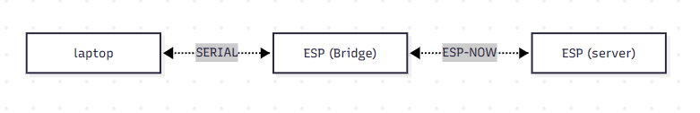

# TASK - FINAL

> **DEADLINE: 25 Oktober 2026**

<p align="center">
  
</p>

## Contents:

- [DESKRIPSI TUGAS](#deskripsi-tugas)
- [DETAIL PENUGASAN](#detail-penugasan)
- [DAFTAR PERUSAHAAN](#daftar-perusahaan)
- [PROGRAM LAPTOP](#program-laptop)
- [ESP-BRIDGE](#esp-bridge)
- [ESP-SERVER](#esp-server)
- [PROTOKOL KOMUNIKASI](#protokol-komunikasi)
- [JSON DAN HEXADECIMAL](#json-dan-hexadecimal)
- [ERROR CODE](#error-code)
- [CARA BERJALAN](#cara-berjalan)
- [PENGUJIAN](#pengujian)

## DESKRIPSI TUGAS

Diminta untuk membuat sebuah sistem terdistribusi yang terdiri dari program laptop dan dua ESP, yaitu ESP-Bridge dan ESP-Server.

Sistem harus mampu menerima permintaan dari pengguna melalui program laptop, meneruskan permintaan tersebut melalui ESP-Bridge menggunakan Serial Communication dan ESP-NOW, kemudian memproses permintaan pada ESP-Server sesuai proses bisnis perusahaan yang dipilih.

Setiap peserta akan mendapatkan satu perusahaan fiktif dengan proses bisnis yang berbeda. Peserta bertanggung jawab merancang dan mengimplementasikan proses bisnis tersebut pada ESP-Server.

Sistem wajib menggunakan JSON sebagai format data aplikasi, representasi hexadecimal untuk pertukaran data sesuai ketentuan, serta token autentikasi sepanjang **6 byte** untuk setiap permintaan yang diproses ESP-Server.

## DETAIL PENUGASAN

Kalian diminta membuat dua program ESP dan satu program laptop.

<p align="center">
  
  <br>
  Diagram komunikasi Laptop, ESP-Bridge, dan ESP-Server.
</p>

Arsitektur komunikasi:

**Laptop ⇄ ESP-Bridge ⇄ ESP-Server**

Media komunikasi:

- Laptop ↔ ESP-Bridge: Serial Communication.
- ESP-Bridge ↔ ESP-Server: ESP-NOW.

### **TODO 1 — PROGRAM LAPTOP**

Buatlah program yang berfungsi sebagai antarmuka pengguna untuk menjalankan proses bisnis perusahaan.

Program harus:

- Menyediakan input sesuai proses bisnis perusahaan.
- Membentuk data permintaan dalam format JSON.
- Mengubah data JSON menjadi representasi hexadecimal sebelum dikirim.
- Mengirim data melalui Serial Communication.
- Menerima respons dari ESP-Bridge.
- Menampilkan hasil yang dapat dibaca pengguna, bukan sekadar rangkaian hexadecimal.

### **TODO 2 — ESP-BRIDGE**

Buatlah program ESP-Bridge sebagai penghubung antara laptop dan ESP-Server.

Program harus:

- Menerima data hexadecimal dari laptop melalui Serial Communication.
- Memvalidasi format data yang diterima.
- Meneruskan permintaan ke ESP-Server melalui ESP-NOW menggunakan protokol yang ditentukan.
- Menyertakan token autentikasi 6 byte dalam setiap permintaan.
- Menerima respons dari ESP-Server.
- Mengubah respons hexadecimal atau kode respons menjadi informasi yang dapat dibaca manusia.
- Meneruskan hasil tersebut ke laptop melalui Serial Communication.
- Menggunakan kode error ringkas saat terjadi kesalahan agar komunikasi tidak membawa pesan panjang yang tidak diperlukan.

ESP-Bridge tidak menjalankan proses bisnis perusahaan. Perangkat ini bertanggung jawab atas komunikasi, validasi format dasar, dan penerjemahan respons.

### **TODO 3 — ESP-SERVER**

Buatlah program ESP-Server yang menjalankan proses bisnis perusahaan masing-masing peserta.

Program harus:

- Menerima paket dari ESP-Bridge melalui ESP-NOW.
- Memvalidasi struktur paket dan token autentikasi.
- Menolak permintaan secara langsung apabila token tidak sesuai.
- Memproses payload jika token valid.
- Mengubah atau membaca representasi hexadecimal menjadi data aplikasi yang diperlukan.
- Memvalidasi JSON dan parameter permintaan.
- Menjalankan proses bisnis sesuai perusahaan yang diperoleh.
- Menghasilkan respons berupa hasil pemrosesan atau kode error.
- Mengirimkan respons kembali ke ESP-Bridge melalui ESP-NOW.

**Ketentuan token:**

- Token memiliki panjang tepat 6 byte.
- Token harus dikirim bersama setiap permintaan dari ESP-Bridge.
- ESP-Server memiliki token valid yang menjadi acuan.
- Jika token yang diterima tidak sama dengan token valid, permintaan langsung ditolak sebelum proses bisnis dijalankan.
- Token tidak boleh diubah menjadi string sepanjang 6 karakter jika yang dimaksud adalah 6 byte. Representasi hexadecimal dari 6 byte token terdiri dari 12 digit hexadecimal.

## DAFTAR PERUSAHAAN

Setiap peserta mendapatkan satu perusahaan dari daftar berikut. Perusahaan pertama digunakan sebagai contoh implementasi, sedangkan 7 perusahaan lainnya tersedia untuk dipilih peserta. Setiap peserta menentukan sendiri proses bisnis yang akan diimplementasikan.

### Contoh Implementasi

<details id="perusahaan-depot-makan-kenyang">
  <summary><b>DEPOT Makan Kenyang</b></summary>

  **Nama Perusahaan:** DEPOT Makan Kenyang

  **Deskripsi:** DEPOT Makan Kenyang merupakan usaha kuliner rumahan yang berada di kawasan kampus dan beroperasi setiap hari mulai pukul 08.00 hingga 21.00. Depot ini menyajikan puluhan pilihan menu, mulai dari paket nasi dengan lauk tunggal, menu sayur dan pecel, hingga aneka minuman segar seperti es teh, es jeruk, dan kopi susu. Karena lokasinya strategis dan harganya terjangkau untuk mahasiswa, permintaan makanan mengalir deras pada jam makan siang (11.30–13.30) dan sore hari (16.00–18.00), sehingga pemilik depot sering kewalahan mencatat pesanan yang masuk secara manual di secarik kertas.

  Selama ini pencatatan pesanan dilakukan dengan tulis tangan, yang menimbulkan tiga masalah berulang. Pertama, harga sering dihitung sendiri oleh pelayan dan tidak jarang meleset dari daftar harga resmi. Kedua, stok bahan harian tidak terpantau, sehingga menu yang sebenarnya sudah habis tetap diterima lalu dibatalkan setelah pelanggan menunggu. Ketiga, tidak ada bukti transaksi yang bisa ditelusuri ketika terjadi complaint, misalnya pesanan yang salah sajikan atau jumlah porsi yang tidak sesuai.

  Sistem ini menggantikan pencatatan manual tersebut. Pelanggan dapat melihat daftar menu, memeriksa harga, memastikan ketersediaan menu, dan melakukan pemesanan berdasarkan jumlah yang diinginkan. Sistem akan memproses pesanan, menghitung total pembayaran secara otomatis dari harga satuan, mengurangi stok porsi, serta memberikan konfirmasi mengenai pesanan yang berhasil dibuat beserta nomor pesanan yang dapat digunakan untuk menelusuri transaksi.

  **Aktor yang terlibat:** Pelanggan (membuat dan menanyakan pesanan), Pelayan (mencatat pesanan dan membaca hasilnya), Kasir (memeriksa keabsahan transaksi harian), Juru Masak/Owner (memperbarui ketersediaan menu dan harga).

  **Entitas data utama:** Menu (ID menu, nama, kategori, harga satuan, stok porsi tersisa, status tersedia), Pesanan (nomor pesanan, daftar item, jumlah tiap item, total harga, status pesanan, waktu pembuatan).

  **Aturan bisnis:**

  - Satu pesanan boleh memuat lebih dari satu item menu, dan setiap item memiliki jumlah porsi.
  - Harga satuan bersifat tetap di sistem dan tidak boleh dikirim oleh pengguna, supaya total tidak dapat dimanipulasi.
  - Pesanan ditolak bila minimal satu item diminta melebihi stok porsi yang tersedia.
  - Pesanan ditolak bila item meminta menu yang statusnya tidak tersedia atau ID-nya tidak terdaftar.
  - Stok porsi dikurangi hanya setelah pesanan dinyatakan berhasil, tidak boleh berkurang saat permintaan hanya memeriksa harga.
  - Total pembayaran dihitung dengan penjumlahan `harga satuan × jumlah` untuk seluruh item, dan disampaikan dalam satuan rupiah bulat.
  - Nomor pesanan dihasilkan sistem sebagai identitas transaksi dan dipakai untuk menanyakan status pesanan pada permintaan berikutnya.

  **Kondisi gagal yang perlu ditangani:** ID menu tidak ditemukan, jumlah nol atau negatif atau bukan angka, menu tidak tersedia atau stok habis, jenis permintaan tidak dikenali.

  **Aktor yg dipilih:** Pelayan. Pelayan menuntaskan pemesanan seorang diri bersama sistem: ia menuliskan menu yang diminta beserta jumlahnya, sistem memeriksa harga dan ketersediaan porsi, menghitung total, lalu menerbitkan nomor pesanan yang langsung ia baca. Pelayan tidak perlu menemui aktor lain untuk menyelesaikan proses ini, dan ia tidak menentukan harga maupun memegang stok.

</details>

### Daftar Perusahaan untuk Peserta

Setiap perusahaan di bawah ini memiliki latar belakang, produk/layanan, entitas data, dan aturan bisnis yang berbeda. Peserta memilih satu aktor dari daftar aktor perusahaan, dengan syarat aktor tersebut sanggup menuntaskan proses bisnis pilihannya sendiri tanpa berinteraksi dengan aktor lain, lalu memilih satu proses bisnis inti yang diimplementasikan. Aturan bisnis yang relevan dengan proses tersebut wajib ikut diimplementasikan agar demonstrasi pengujian lebih meyakinkan.

<details id="perusahaan-1-kilatexpress">
  <summary><b>1. KilatExpress</b></summary>

  **Nama Perusahaan:** KilatExpress

  **Deskripsi:** KilatExpress merupakan perusahaan jasa pengiriman barang yang melayani rute antar-kota dan antar-provinsi dengan armada truk ekspedisi serta jaringan agen penerima di beberapa wilayah. Perusahaan ini berdiri untuk melayani kebutuhan pelaku usaha kecil yang rutin mengirim barang dalam volume sedang, misalnya toko pakaian, penjual oleh-oleh, dan penjual perlengkapan hobi. Karena pelanggan sering bertanya "paket saya sudah sampai mana?", manajemen ingin setiap transaksi pengiriman memiliki identitas tunggal berupa nomor resi yang dapat ditelusuri statusnya dari awal diterima agen hingga dinyatakan tiba.

  Layanan yang tersedia terbagi menjadi beberapa kelas, yaitu reguler dengan estimasi 3–5 hari, ekspres dengan estimasi 1–2 hari, dan instan untuk rute dalam kota dengan estimasi hitungan jam. Biaya pengiriman tidak ditentukan secara manual oleh agen, melainkan dihitung dari kombinasi berat paket, tarif per kilogram pada kelas layanan yang dipilih, serta biaya tambahan asuransi opsional. Paket dengan berat di bawah batas minimum tetap dikenakan tarif satuan, sedangkan paket yang melebihi batas berat maksimum untuk satu resi harus dipecah menjadi beberapa pengiriman terpisah.

  Pelanggan dapat membuat permintaan pengiriman dengan memasukkan berat paket dan jenis layanan yang diinginkan, lalu sistem akan menghitung biaya pengiriman, menghasilkan nomor resi sebagai identitas transaksi, dan menyediakan informasi status pengiriman berdasarkan nomor resi tersebut. Status perjalanan paket mengikuti alur baku, misalnya diterima agen, dalam perjalanan, tiba di kota tujuan, dan selesai, sehingga setiap permintaan pelacakan mengembalikan posisi terakhir paket.

  **Aktor yang terlibat:** Pengirim (membuat permintaan pengiriman), Penerima (menjadi tujuan paket), Agen/Kurir (memperbarui status perjalanan), Pelacak (menanyakan status lewat resi).

  **Entitas data utama:** Kiriman (nomor resi, berat paket, jenis layanan, asal, tujuan, biaya, asuransi, status, waktu pembuatan), Tarif layanan (kode kelas layanan, tarif per kilogram, estimasi durasi, batas berat minimum dan maksimum), Status perjalanan (resi, status saat ini, riwayat status).

  **Aturan bisnis:**

  - Berat paket harus berupa angka positif; paket nol, negatif, atau bukan angka ditolak.
  - Kelas layanan harus salah satu yang terdaftar; kelas yang tidak dikenal ditolak.
  - Biaya dihitung `tarif per kilogram × berat` ditambah ongkos dasar dan premi asuransi bila diminta, dibulatkan ke rupiah.
  - Berat di bawah minimum tetap dihitung satu satuan tarif minimum; berat di atas maksimum ditolak untuk satu resi.
  - Nomor resi dihasilkan sistem (bukan dikirim pelanggan) supaya tidak ada dua transaksi dengan identitas sama.
  - Pelacakan hanya berhasil untuk resi yang benar-benar pernah dibuat; resi tak dikenal ditolak.
  - Status hanya boleh bergerak maju sesuai alur baku, tidak boleh kembali ke status sebelumnya.

  **Kondisi gagal yang perlu ditangani:** berat atau kelas layanan tidak valid, resi tidak ditemukan, berat melebihi maksimum layanan, permintaan tanpa identitas sah.

  **Aktor yg dipilih:** [pilihan Peserta] — satu aktor dari daftar aktor di atas, yang sanggup menuntaskan proses bisnis pilihannya sendiri tanpa berinteraksi dengan aktor lain

</details>

<details id="perusahaan-2-bukukita">
  <summary><b>2. BukuKita</b></summary>

  **Nama Perusahaan:** BukuKita

  **Deskripsi:** BukuKita merupakan layanan pengelolaan koleksi buku yang berfungsi sebagai perpustakaan komunitas di lingkungan kampus. Koleksinya mencakup buku teks teknik, buku pengayaan, novel, dan kumpulan referensi yang dibeli secara bertahap dari hasil iuran anggota. Setiap judul dapat memiliki lebih dari satu eksemplar fisik, dan peminjaman dilakukan di meja layanan dengan mencatat ID buku, identitas peminjam, serta lama waktu peminjaman.

  Masalah yang sering muncul adalah buku yang sudah habis dipinjam tetap tercatat "tersedia" karena stok diperbarui manual, dan denda keterlambatan tidak pernah dihitung konsisten. Karena itu sistem perlu memastikan status stok selalu berubah setiap ada transaksi peminjaman dan pengembalian. Masa pinjam dihitung dalam hari, dengan batas maksimum durasi peminjaman yang berlaku sama untuk semua anggota, kecuali buku referensi tertentu yang hanya boleh dipinjam dalam jangka pendek atau tidak boleh dipinjam keluar sama sekali.

  Pengguna dapat melihat informasi buku, memeriksa ketersediaan stok, dan mengajukan peminjaman berdasarkan ID buku serta durasi peminjaman. Sistem akan memvalidasi permintaan, mencatat transaksi peminjaman beserta tanggal jatuh tempo, menolak permintaan apabila jumlah buku yang tersedia tidak mencukupi, lalu memperbarui stok ketika buku dikembalikan. Peminjam yang sama dapat memiliki beberapa peminjaman aktif, namun dibatasi pada jumlah maksimum judul yang sedang dipegang agar satu orang tidak memonopoli koleksi.

  **Aktor yang terlibat:** Anggota/Peminjam (mengajukan peminjaman dan pengembalian), Pustakawan (mengelola katalog dan mencatat transaksi).

  **Entitas data utama:** Buku (ID buku, judul, pengarang, kategori, total eksemplar, stok tersedia, batas durasi maksimum), Peminjaman (ID transaksi, ID buku, ID peminjam, tanggal pinjam, tanggal jatuh tempo, status, jumlah hari), Anggota (ID peminjam, nama, jumlah peminjaman aktif).

  **Aturan bisnis:**

  - Durasi peminjaman harus angka positif dan tidak boleh melebihi batas durasi maksimum buku tersebut.
  - Peminjaman ditolak bila stok tersedia nol, dan stok dikurangi tepat satu per eksemplar yang dipinjam.
  - Satu peminjam tidak boleh memiliki peminjaman aktif melebihi batas maksimum yang ditetapkan.
  - ID buku dan ID peminjam harus terdaftar; jika tidak, permintaan ditolak sebelum pencatatan.
  - Buku yang sama tidak boleh dipinjam dua kali oleh peminjam yang sama dalam satu transaksi.
  - Pengembalian hanya sah untuk transaksi berstatus dipinjam, dan mengembalikan stok ke katalog.
  - Denda dihitung dari selisih hari keterlambatan dikalikan tarif denda per hari.

  **Kondisi gagal yang perlu ditangani:** ID buku tidak ada, durasi tidak valid, stok habis atau melampaui batas peminjaman aktif, transaksi pengembalian ganda, permintaan tanpa identitas sah.

  **Aktor yg dipilih:** [pilihan Peserta] — satu aktor dari daftar aktor di atas, yang sanggup menuntaskan proses bisnis pilihannya sendiri tanpa berinteraksi dengan aktor lain

</details>

<details id="perusahaan-3-its-parkir">
  <summary><b>3. ITS-Parkir</b></summary>

  **Nama Perusahaan:** ITS-Parkir

  **Deskripsi:** ITS-Parkir merupakan layanan pengelolaan area parkir kendaraan di lingkungan kampus yang mengelola beberapa zona parkir terpisah untuk mobil dan sepeda motor. Setiap zona memiliki jumlah slot yang tetap, misalnya puluhan slot mobil dan ratusan slot motor, sehingga pada jam sibuk gerbang pintu parkir sering penuh dan kendaraan harus dialihkan ke zona lain. Pengelolaan manual dengan karcis kertas membuat kapasitas real-time tidak pernah diketahui dengan benar dan tarif sering dihitung asal oleh petugas gerbang.

  Sistem ini mencatat kendaraan yang masuk dan keluar secara elektronik. Petugas mendaftarkan kendaraan yang masuk dengan memasukkan nomor pelat kendaraan ke program laptop. Sistem memeriksa apakah zona tujuan masih memiliki slot kosong, menghasilkan tiket parkir sebagai bukti masuk, mencatat waktu masuk, lalu menahan satu slot. Ketika kendaraan keluar, sistem mencari tiket berdasarkan pelat, menghitung durasi parkir dalam satuan menit atau jam, menagih biaya sesuai tarif zona dan golongan kendaraan, dan membebaskan slot kembali.

  Tarif berlaku berlapis: ada tarif untuk pecahan jam pertama, tarif per jam berikutnya, serta tarif maksimum harian. Terdapat pula perlakuan khusus untuk kendaraan berlangganan yang mendapat tarif tetap dan bebas memeriksa ketersediaan slot harian. Kendaraan yang masuk dan keluar dalam rentang waktu sangat singkat (misalnya hanya berhenti untuk menurunkan penumpang) dikenakan tarif gratis atau tarif minimum sesuai kebijakan gerbang.

  **Aktor yang terlibat:** Pengendara (kendaraan masuk dan keluar), Petugas gerbang (mendaftarkan transaksi), Pengelola (memantau kapasitas dan tarif).

  **Entitas data utama:** Zona parkir (ID zona, jenis kendaraan, total slot, slot terisi, tarif per jam, tarif maksimum harian), Tiket (ID tiket, nomor pelat, ID zona, waktu masuk, waktu keluar, durasi, biaya), Langganan (nomor pelat, jenis kendaraan, tarif tetap).

  **Aturan bisnis:**

  - Nomor pelat wajib diisi, tidak boleh kosong, dan harus mengikuti format yang diizinkan.
  - Tidak boleh ada dua kendaraan aktif dengan pelat yang sama di dalam area parkir.
  - Pendaftaran masuk ditolak bila slot zona sudah penuh, dan slot terisi bertambah hanya setelah tiket dibuat.
  - Transaksi keluar hanya sah bila pelat tersebut benar-benar memiliki tiket aktif; pelat tak dikenal ditolak.
  - Durasi parkir dihitung dari selisih waktu keluar dan waktu masuk, dan biaya tidak pernah bernilai negatif.
  - Biaya mengikuti tarif berlapis dan dibulatkan sesuai pembulatan jam.
  - Pembaruan kapasitas (slot terisi berkurang) wajib terjadi setelah kendaraan keluar.

  **Kondisi gagal yang perlu ditangani:** pelat tidak valid/kosong, pelat tidak memiliki tiket aktif, zona penuh, kapasitas tidak konsisten, permintaan tanpa identitas sah.

  **Aktor yg dipilih:** [pilihan Peserta] — satu aktor dari daftar aktor di atas, yang sanggup menuntaskan proses bisnis pilihannya sendiri tanpa berinteraksi dengan aktor lain

</details>

<details id="perusahaan-4-freshmart">
  <summary><b>4. FreshMart</b></summary>

  **Nama Perusahaan:** FreshMart

  **Deskripsi:** FreshMart merupakan toko kebutuhan sehari-hari yang menyediakan berbagai produk seperti beras, minyak goreng, gula, telur, tepung, dan kebutuhan rumah tangga lainnya. Toko ini melayani pembelian langsung di tempat dengan sistem kasir, di mana satu struk belanja dapat memuat banyak jenis produk sekaligus. Stok barang dibeli dari distributor dalam jumlah besar lalu dijual eceran, sehingga pembaruan stok akibat transaksi harian tidak pernah sinkron dengan catatan gudang dan sering baru diketahui saat barang sudah habis di rak.

  Sistem ini menjaga data katalog dan stok tetap akurat pada saat transaksi terjadi. Pelanggan dapat melihat daftar produk, memeriksa harga dan sisa stok, serta menentukan jumlah barang yang ingin dibeli dalam satu permintaan belanja. Sistem akan memvalidasi jumlah pembelian, menghitung total belanja dari harga satuan tiap produk, memproses transaksi, menghasilkan nomor struk, dan mengurangi stok produk hanya setelah pembelian berhasil dilakukan.

  Karena sebagian produk dijual dengan batas pembelian (misalnya minyak goreng subsidi yang dibatasi per orang) dan sebagian produk lain memiliki satuan khusus seperti kilogram atau lusin, sistem perlu membedakan kuantitas minimum, kuantitas maksimum, dan satuan yang sah. Harga selalu bersumber dari katalog di sisi sistem, sehingga tidak mungkin pelanggan mengirim harga sendiri untuk memanipulasi total struk.

  **Aktor yang terlibat:** Pelanggan (menentukan barang dan jumlah), Kasir (memproses transaksi dan menyerahkan struk), Staf gudang (memperbarui harga dan stok).

  **Entitas data utama:** Produk (ID produk, nama, kategori, satuan, harga, stok, batas beli maksimum), Transaksi/Struk (nomor struk, daftar item, total belanja, waktu transaksi), Item struk (ID produk, jumlah, subtotal).

  **Aturan bisnis:**

  - Setiap item harus merujuk ID produk yang terdaftar; satu struk boleh memuat beberapa produk berbeda.
  - Jumlah pembelian harus angka positif dan tidak boleh melebihi stok maupun batas beli maksimum produk.
  - Harga diambil dari katalog sistem, bukan dari permintaan pelanggan.
  - Total belanja adalah penjumlahan `harga × jumlah` untuk seluruh item dalam struk.
  - Pengurangan stok terjadi sekali saja untuk satu transaksi yang berhasil (tidak boleh dobel saat pelanggan mengirim ulang permintaan).
  - Produk dengan stok nol tidak dapat dijual dan harus dilaporkan sebagai tidak tersedia.
  - Nomor struk dihasilkan sistem sebagai identitas transaksi.

  **Kondisi gagal yang perlu ditangani:** ID produk tidak ditemukan, jumlah nol/negatif/bukan angka atau melewati batas, stok tidak mencukupi, permintaan tanpa identitas sah.

  **Aktor yg dipilih:** [pilihan Peserta] — satu aktor dari daftar aktor di atas, yang sanggup menuntaskan proses bisnis pilihannya sendiri tanpa berinteraksi dengan aktor lain

</details>

<details id="perusahaan-5-kliniksehat">
  <summary><b>5. KlinikSehat</b></summary>

  **Nama Perusahaan:** KlinikSehat

  **Deskripsi:** KlinikSehat merupakan layanan kesehatan tingkat pertama yang mengelola pendaftaran kunjungan pasien dan antrean untuk berbagai jenis layanan pemeriksaan, seperti pemeriksaan umum, konsultasi gigi, layanan bidan, tindakan keperawatan, dan kelas senam lansia. Setiap jenis layanan dijalankan oleh satu atau lebih tenaga medis dengan jadwal tertentu, misalnya pagi dan sore, serta memiliki kuota maksimum jumlah pasien per sesi agar waktu konsultasi per pasien tetap memadai.

  Pendaftaran manual di loket menimbulkan dua keluhan utama: pasien datang tanpa kepastian dapat terlayani pada hari itu, dan nomor antrean ditulis ulang sehingga urutan panggil tidak akurat. Karena itu sistem perlu menjadi pencatat tunggal kuota dan antrean. Pasien dapat memilih layanan yang tersedia dan mengajukan pendaftaran dengan memasukkan informasi yang diperlukan. Sistem akan memeriksa jadwal dan kuota layanan, memvalidasi permintaan pendaftaran, menghasilkan nomor antrean bagi pasien yang berhasil terdaftar, serta menolak pendaftaran apabila kuota telah penuh.

  Selain pendaftaran, klinik membutuhkan pembatalan agar kuota yang dilepaskan bisa dipakai pasien lain, dan pelacakan antrean agar pasien dapat menanyakan posisinya tanpa menunggu di ruang tunggu. Nomor antrean berlaku unik per layanan per hari, sehingga dua pasien tidak pernah memegang angka yang sama pada sesi yang sama, dan pasien yang sama tidak dapat mendaftar dua kali untuk layanan yang sama pada hari yang sama.

  **Aktor yang terlibat:** Pasien (mendaftar, membatalkan, menanyakan antrean), Petugas loket (memproses pendaftaran), Tenaga medis/dokter (menjalankan sesi layanan dan memanggil antrean).

  **Entitas data utama:** Layanan (ID layanan, nama layanan, kode poli, kuota per sesi, sesi waktu, tarif), Pendaftaran (ID pendaftaran, ID layanan, identitas pasien, tanggal, nomor antrean, status), Pasien (nomor identitas pasien, nama, keluhan singkat).

  **Aturan bisnis:**

  - ID layanan harus terdaftar dan pendaftarannya harus menunjuk sesi yang masih membuka pendaftaran.
  - Nomor identitas pasien serta pilihan layanan wajib diisi; format tidak sesuai ditolak.
  - Satu pasien tidak boleh memiliki dua pendaftaran aktif untuk layanan yang sama pada hari yang sama.
  - Nomor antrean dihasilkan sistem dan melanjutkan urutan terakhir sesi tersebut, tidak boleh dipilih oleh pengguna.
  - Pendaftaran ditolak bila kuota sesi sudah terisi penuh, dan pembatalan wajib mengembalikan kuota tersebut.
  - Pembatalan hanya sah untuk pendaftaran berstatus terdaftar, bukan untuk yang sudah selesai atau belum pernah ada.

  **Kondisi gagal yang perlu ditangani:** layanan tidak ditemukan, parameter pendaftaran tidak lengkap, kuota penuh, pendaftaran ganda, permintaan tanpa identitas sah.

  **Aktor yg dipilih:** [pilihan Peserta] — satu aktor dari daftar aktor di atas, yang sanggup menuntaskan proses bisnis pilihannya sendiri tanpa berinteraksi dengan aktor lain

</details>

<details id="perusahaan-6-servislaen">
  <summary><b>6. ServisLaen</b></summary>

  **Nama Perusahaan:** ServisLaen

  **Deskripsi:** ServisLaen merupakan layanan perbaikan perangkat elektronik yang menerima permintaan servis untuk perangkat seperti laptop, komputer, dan telepon seluler, dengan pekerjaan yang mencakup penggantian komponen, pembersihan sistem, instalasi ulang, hingga perbaikan kerusakan fisik. Setiap pekerjaan yang masuk harus memiliki identitas agar pelanggan dan teknisi berbicara tentang benda yang sama, karena perangkat yang dititipkan akan berada di bengkel selama beberapa hari sampai beberapa minggu.

  Proses dimulai ketika pelanggan mengajukan servis dengan mencantumkan jenis perangkat, merek, dan keluhan yang dialami. Sistem akan membuat tiket servis sebagai identitas permintaan, memberikan estimasi biaya perbaikan awal berdasarkan jenis perangkat dan kategori keluhan, serta mencatat status pengerjaan yang bergerak dari diterima, sedang diperiksa, menunggu komponen, selesai, hingga diambil pelanggan. Pelanggan dapat memeriksa status pengerjaan berdasarkan ID tiket kapan saja.

  Estimasi biaya terdiri dari jasa pemeriksaan dan perkiraan harga komponen. Ketika teknisi menemukan kerusakan tambahan, biaya final dapat melebihi estimasi dan selisihnya harus tetap tercatat pada tiket yang sama. Ada pula kebijakan bahwa tiket yang sudah selesai tetapi tidak diambil melewati batas waktu tertentu dikenakan biaya titip harian, dan tiket yang dibatalkan pelanggan tidak menghapus catatan riwayat perangkat.

  **Aktor yang terlibat:** Pelanggan (mengajukan servis, menanyakan status, mengambil perangkat), Teknisi (memperbarui status dan biaya), Front office (menerima perangkat dan menyerahkan tiket).

  **Entitas data utama:** Tiket servis (ID tiket, jenis perangkat, merek, model, keluhan, estimasi biaya, biaya final, status, tanggal masuk, tanggal selesai), Daftar tarif (jenis perangkat, kategori kerusakan, biaya jasa, perkiraan komponen), Riwayat status (ID tiket, status, keterangan, waktu pembaruan).

  **Aturan bisnis:**

  - Jenis perangkat dan keluhan wajib diisi; keluhan kosong atau terlalu pendek tidak dapat diterima.
  - Estimasi biaya dihitung sistem dari kombinasi jenis perangkat dan kategori keluhan, bukan dikirim pelanggan.
  - ID tiket dihasilkan sistem dan tidak boleh duplikat.
  - Pembaruan status hanya boleh berpindah ke status berikutnya yang sah, dan status selesai menutup perhitungan durasi pengerjaan.
  - Biaya final harus lebih besar atau sama dengan nol dan tercatat sebagai penggantian estimasi, bukan estimasi baru.
  - Pelacakan status hanya berhasil untuk tiket yang ada; ID tiket tak dikenal ditolak.
  - Perhitungan biaya tambahan dapat dikenakan bila perangkat selesai tetapi belum diambil melewati batas waktu simpan.

  **Kondisi gagal yang perlu ditangani:** data perangkat/keluhan tidak valid, ID tiket tidak ditemukan, perpindahan status tidak sah, permintaan tanpa identitas sah.

  **Aktor yg dipilih:** [pilihan Peserta] — satu aktor dari daftar aktor di atas, yang sanggup menuntaskan proses bisnis pilihannya sendiri tanpa berinteraksi dengan aktor lain

</details>

<details id="perusahaan-7-laundrycepat">
  <summary><b>7. LaundryCepat</b></summary>

  **Nama Perusahaan:** LaundryCepat

  **Deskripsi:** LaundryCepat merupakan layanan pencucian pakaian yang menawarkan beberapa pilihan layanan, seperti cuci reguler dengan pengerjaan 2–3 hari, cuci ekspres selesai dalam 1×24 jam, setrika saja tanpa pencucian, serta layanan tambahan seperti cuci sepatu dan pembersih bed cover yang dihitung sebagai item terpisah. Biaya dasar ditentukan dari berat pakaian dalam kilogram, lalu dikalikan tarif per kilogram pada kelas layanan yang dipilih dan ditambah biaya layanan tambahan bila pelanggan memintanya.

  Pelanggan datang menghantar pakaian dalam kantong, lalu petugas menimbang dan mencatat jenis cucian. Pelanggan sering kali ingin tahu apakah pakaiannya sudah selesai tanpa harus datang dua kali, sehingga setiap pesanan diberi nomor transaksi yang dapat digunakan untuk menanyakan perkembangan pengerjaan hingga status diambil. Order yang sudah diterima tidak boleh hilang, dan biaya yang diinformasikan di awal harus sama dengan tagihan saat pengambilan.

  Sistem akan memvalidasi data pesanan, menghitung total biaya, menghasilkan nomor transaksi, serta memperbarui status pengerjaan. Berat memiliki batas minimum tagihan, sehingga pesanan yang sangat ringan tetap dikenakan tarif dasar. Pesanan yang melebihi kapasitas harian mesin juga perlu ditolak atau dijadwalkan ulang agar janji selesai tidak meleset, dan pesanan ekspres hanya diterima sampai batas jam tertentu pada hari yang sama.

  **Aktor yang terlibat:** Pelanggan (menyetor cucian, menanyakan status, mengambil cucian), Petugas kasir (membuat pesanan dan menimbang), Operator mesin (memperbarui status pengerjaan).

  **Entitas data utama:** Pesanan (nomor transaksi, berat, jenis layanan, layanan tambahan, total biaya, status, tanggal masuk, tanggal siap), Daftar tarif (kode layanan, tarif per kilogram, durasi pengerjaan, batas jam terima), Status pengerjaan (nomor transaksi, status saat ini, waktu pembaruan).

  **Aturan bisnis:**

  - Berat harus angka positif; layanan harus salah satu kelas yang terdaftar.
  - Total biaya dihitung `tarif per kilogram × berat` ditambah biaya layanan tambahan, dengan pembulatan ke atas dan penerapan tarif minimum.
  - Pesanan ekspres yang masuk setelah batas jam terima tidak dapat dijanjikan selesai dalam 1×24 jam dan harus ditolak atau dialihkan ke reguler.
  - Nomor transaksi dihasilkan sistem dan menjadi satu-satunya acuan pelacakan.
  - Status hanya bergerak maju sesuai alur baku, dan pengambilan hanya sah bila status sudah siap diambil.
  - Pelacakan dengan nomor transaksi tak dikenal ditolak.

  **Kondisi gagal yang perlu ditangani:** berat atau jenis layanan tidak valid, transaksi tidak ditemukan, melewati batas jam ekspres atau kapasitas harian, permintaan tanpa identitas sah.

  **Aktor yg dipilih:** [pilihan Peserta] — satu aktor dari daftar aktor di atas, yang sanggup menuntaskan proses bisnis pilihannya sendiri tanpa berinteraksi dengan aktor lain

</details>

Catatan: Peserta menentukan proses bisnis yang akan diimplementasikan sesuai perusahaan pilihannya, kemudian menyesuaikan bentuk permintaan dan hasil yang ditampilkan dengan ketentuan komunikasi pada bagian PROTOKOL KOMUNIKASI. Aktor yang dipilih hanya bertukar permintaan dan hasil dengan sistem, tanpa memerlukan percakapan dengan aktor lain.

## PROGRAM LAPTOP

**PROGRAM INPUT DAN SERIAL COMMUNICATION**

**DESKRIPSI**

Program laptop menjadi antarmuka pengguna untuk mengirim permintaan sesuai proses bisnis perusahaan yang diperoleh.

**KETENTUAN**

- Bahasa pemrograman bebas.
- Program harus dapat membentuk JSON sesuai proses bisnis.
- JSON harus dikonversi menjadi representasi hexadecimal sebelum dikirim melalui serial.
- Program mengirim data ke ESP-Bridge melalui Serial Communication.
- Program menerima respons dari ESP-Bridge.
- Program menampilkan hasil dalam bentuk yang dapat dibaca manusia.
- Program tidak perlu mengetahui detail implementasi internal ESP-Server.

**NILAI PLUS**

- Mengimplementasikan OOP.
- Menggunakan `CMakeLists.txt`.
- Memisahkan modul JSON, serial communication, dan tampilan.

## ESP-BRIDGE

**SERIAL ↔ ESP-NOW BRIDGE**

**DESKRIPSI**

ESP-Bridge bertanggung jawab meneruskan data dari laptop ke ESP-Server serta menerjemahkan respons menjadi informasi yang dapat dibaca pengguna.

**KETENTUAN**

- Menggunakan ESP32 dan Arduino Framework.
- Menerima data hexadecimal dari laptop melalui serial.
- Memvalidasi karakter dan struktur data yang diterima.
- Mengirim permintaan kepada ESP-Server melalui ESP-NOW.
- Menyertakan token 6 byte dalam setiap paket permintaan.
- Menerima respons dari ESP-Server.
- Mengubah kode respons atau data hexadecimal menjadi bentuk yang dapat dibaca.
- Mengirim hasil yang sudah diterjemahkan kepada laptop melalui serial.
- Tidak menjalankan proses bisnis perusahaan.

**KOMUNIKASI MINIMAL**

Data yang dikirimkan harus meminimalkan informasi tekstual yang tidak diperlukan.

Contoh respons ringkas dari ESP-Server:

```text
E01
```

ESP-Bridge menerjemahkan kode tersebut menjadi:

```text
Token tidak valid.
```

Penjelasan lengkap setiap kode error disediakan pada bagian ERROR CODE. Dengan demikian, komunikasi perangkat cukup membawa kode ringkas, sedangkan pengguna tetap menerima penjelasan yang mudah dipahami.

## ESP-SERVER

**BUSINESS LOGIC DAN TOKEN VALIDATION**

**DESKRIPSI**

ESP-Server menjalankan proses bisnis sesuai perusahaan yang diperoleh masing-masing peserta. Perangkat ini merupakan satu-satunya komponen yang bertanggung jawab menjalankan logika bisnis utama.

**KETENTUAN**

1. Menerima paket dari ESP-Bridge menggunakan ESP-NOW.
2. Memvalidasi struktur paket dan panjang data.
3. Membandingkan token yang diterima dengan token valid yang tersimpan di ESP-Server.
4. Jika token berbeda, langsung menolak permintaan dan mengembalikan kode error `E01`.
5. Jika token valid, melanjutkan pemeriksaan payload.
6. Mengonversi representasi hexadecimal menjadi data JSON yang dapat diparsing.
7. Memvalidasi action dan parameter permintaan.
8. Menjalankan proses bisnis sesuai perusahaan.
9. Menghasilkan respons ringkas yang berisi status, data hasil, atau kode error.
10. Mengirim respons kembali kepada ESP-Bridge melalui ESP-NOW.

**ATURAN TOKEN**

- Panjang token: 6 byte.
- Token harus dibandingkan sebagai 6 byte, bukan sebagai enam karakter.
- Token yang salah harus ditolak sebelum proses bisnis dijalankan.
- Token yang valid tidak menjamin permintaan berhasil; JSON dan parameter tetap harus divalidasi.
- Token valid harus dikonfigurasi pada ESP-Bridge dan ESP-Server. Untuk pengembangan, token dapat disimpan sebagai konstanta firmware; jangan mencetak token lengkap ke log.

**CONTOH PROSES BISNIS**

Pada perusahaan DEPOT Makan Kenyang, ESP-Server menerima permintaan pemesanan makanan. Setelah token dinyatakan valid, server memeriksa ID menu, jumlah pesanan, ketersediaan menu, dan harga. Jika semua valid, server menghitung total harga dan mengirimkan hasil transaksi kepada ESP-Bridge.

## PROTOKOL KOMUNIKASI

**FORMAT PAKET ESP-NOW**

**DESKRIPSI**

Peserta wajib mengimplementasikan protokol komunikasi sendiri untuk pengiriman data antara ESP-Bridge dan ESP-Server.

**STRUKTUR MINIMUM**

| Field | Ukuran | Fungsi |
|---|---:|---|
| HEADER | 4 byte | Penanda atau identitas protokol |
| SOURCE | 1 byte | Identitas pengirim |
| DESTINATION | 1 byte | Identitas tujuan |
| TOKEN | 6 byte | Autentikasi permintaan |
| LENGTH | 2 byte | Panjang payload |
| PAYLOAD | Variabel | Data aplikasi dalam representasi hexadecimal |

**KETENTUAN**

- Field `MESSAGE TYPE` tidak digunakan.
- Ukuran dan urutan field harus konsisten pada kedua perangkat.
- Nilai `SOURCE` dan `DESTINATION` harus didokumentasikan.
- Panjang payload harus sesuai dengan jumlah data aktual.
- Paket yang tidak lengkap atau tidak sesuai struktur harus ditolak.
- Token selalu diperiksa sebelum payload diproses.
- Peserta wajib mendokumentasikan contoh paket yang dikirim dan diterima.

**CATATAN ENCODING**

Representasi hexadecimal adalah cara menuliskan nilai byte menggunakan digit `0–9` dan `A–F`. Untuk menjaga komunikasi tetap ringkas, implementasi harus membedakan antara teks hexadecimal ASCII dan byte hasil decoding-nya.

Apabila payload dikirim sebagai teks hexadecimal ASCII, ukurannya menjadi dua kali jumlah byte data aslinya. Oleh karena itu, gunakan representasi hexadecimal tekstual hanya sesuai kebutuhan protokol; jika protokol mengizinkan, transmisi byte hasil decoding lebih hemat bandwidth.

Jika data melebihi batas payload ESP-NOW, peserta harus memecah data menjadi beberapa paket dan menyusunnya kembali di sisi penerima.

## JSON DAN HEXADECIMAL

**DATA ENCODING DAN DECODING**

**DESKRIPSI**

JSON digunakan sebagai format data aplikasi, tetapi data tersebut harus diubah menjadi representasi hexadecimal sebelum dikirim sesuai ketentuan tugas.

**CONTOH**

JSON awal:

```json
{
  "action": "cek"
}
```

Setelah diserialisasi menjadi teks JSON UTF-8, setiap byte direpresentasikan menggunakan dua digit hexadecimal. Contoh awal teks JSON:

```text
{"action":"cek"}
```

Representasi hexadecimal:

```text
7B22616374696F6E223A2263656B227D
```

**ALUR PENGIRIMAN**

1. Laptop membentuk JSON.
2. Laptop mengubah byte JSON menjadi representasi hexadecimal.
3. Laptop mengirimkan data ke ESP-Bridge melalui serial.
4. ESP-Bridge memvalidasi dan meneruskan payload melalui ESP-NOW sesuai format protokol.
5. ESP-Server memvalidasi token terlebih dahulu.
6. Jika token valid, ESP-Server mengubah payload hexadecimal menjadi byte JSON dan melakukan parsing.
7. ESP-Server memproses permintaan dan mengirimkan respons.
8. ESP-Bridge menerjemahkan respons atau kode error menjadi teks yang dapat dibaca.

**KETENTUAN**

- Encoding dan decoding harus konsisten.
- Data hexadecimal yang tidak valid harus ditolak.
- Panjang data harus sesuai dengan field `LENGTH`.
- JSON hanya diparsing setelah payload berhasil direkonstruksi.
- Peserta wajib menyediakan contoh JSON, representasi hexadecimal, dan hasil decoding-nya.

## ERROR CODE

**DAFTAR KODE ERROR**

ESP-Server mengirimkan kode error ringkas. ESP-Bridge menerjemahkan kode tersebut menjadi penjelasan yang mudah dibaca pengguna.

| Kode | Arti | Penjelasan yang ditampilkan |
|---|---|---|
| `E01` | Token tidak valid | Token autentikasi tidak sesuai. |
| `E02` | Header tidak valid | Paket tidak memiliki header yang benar. |
| `E03` | Panjang data tidak valid | Panjang payload tidak sesuai dengan data aktual. |
| `E04` | Hexadecimal tidak valid | Payload berisi karakter atau format hexadecimal yang salah. |
| `E05` | JSON tidak valid | Payload tidak dapat diparsing sebagai JSON. |
| `E06` | Action tidak dikenal | Jenis permintaan tidak didukung oleh server. |
| `E07` | Parameter tidak valid | Parameter wajib tidak tersedia atau nilainya tidak sesuai. |
| `E08` | Data tidak ditemukan | Data yang diminta tidak tersedia. |
| `E09` | Proses bisnis gagal | Permintaan ditolak karena aturan proses bisnis. |
| `E10` | Timeout | Respons tidak diterima dalam batas waktu yang ditentukan. |
| `E11` | Tujuan tidak valid | Identitas tujuan paket tidak sesuai. |
| `E12` | Pemrosesan gagal | Terjadi kesalahan internal saat memproses permintaan. |

**KETENTUAN**

- Kode error harus konsisten antara ESP-Server dan ESP-Bridge.
- ESP-Bridge wajib memiliki pemetaan kode error ke penjelasan.
- Komunikasi cukup membawa kode error jika tidak diperlukan data tambahan.
- Kode error harus ditampilkan sebagai pesan yang dapat dibaca pada laptop.
- Kode `E01` wajib digunakan ketika token tidak valid.
- Peserta boleh menambahkan kode error lain sesuai proses bisnisnya.

## CARA BERJALAN

1. Konfigurasikan token 6 byte yang sama pada ESP-Bridge dan ESP-Server.
2. Konfigurasikan MAC Address ESP-Bridge dan ESP-Server.
3. Jalankan firmware ESP-Server.
4. Jalankan firmware ESP-Bridge.
5. Hubungkan ESP-Bridge ke laptop melalui Serial Communication.
6. Jalankan program laptop dan pilih port serial yang sesuai.
7. Pengguna memasukkan permintaan berdasarkan proses bisnis perusahaan.
8. Laptop membentuk JSON dan mengubahnya menjadi representasi hexadecimal.
9. ESP-Bridge menerima data serial dan meneruskannya ke ESP-Server melalui ESP-NOW.
10. ESP-Server memvalidasi token. Jika tidak cocok, server menolak permintaan dan mengembalikan `E01`.
11. Jika token valid, ESP-Server memvalidasi payload dan menjalankan proses bisnis.
12. ESP-Server mengirimkan hasil atau kode error kembali ke ESP-Bridge.
13. ESP-Bridge menerjemahkan respons dan mengirimkannya ke laptop.
14. Laptop menampilkan hasil akhir kepada pengguna.

## PENGUJIAN

Peserta wajib mendemonstrasikan:

- Permintaan valid dengan token yang benar berhasil diproses.
- Permintaan dengan token yang salah langsung ditolak oleh ESP-Server.
- JSON berhasil dikonversi ke hexadecimal dan direkonstruksi kembali.
- Proses bisnis perusahaan berjalan sesuai rancangan.
- Respons berhasil dikembalikan ke laptop.
- Kode error dari ESP-Server diterjemahkan menjadi pesan yang mudah dipahami.
- JSON tidak valid dan action tidak dikenal ditangani dengan benar.
- Paket yang panjangnya tidak sesuai ditolak.
- Log komunikasi dapat digunakan untuk menelusuri alur data.

**NILAI PLUS PROGRAM LAPTOP**

- Mengimplementasikan OOP.
- Menggunakan `CMakeLists.txt`.
- Memisahkan modul JSON, serial communication, dan tampilan.

**NILAI PLUS PROGRAM ESP**

- Mengimplementasikan header dan pemisahan modul.
- Mengimplementasikan protokol komunikasi terstruktur.
- Memiliki timeout dan mekanisme penanganan kegagalan.
- Menggunakan EEPROM atau Flash untuk penyimpanan data jika relevan.
